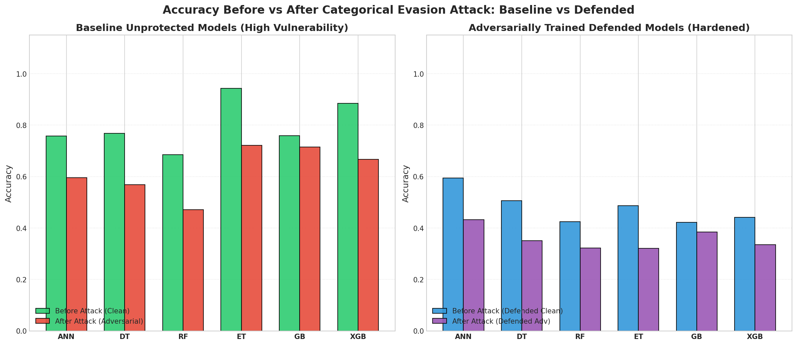
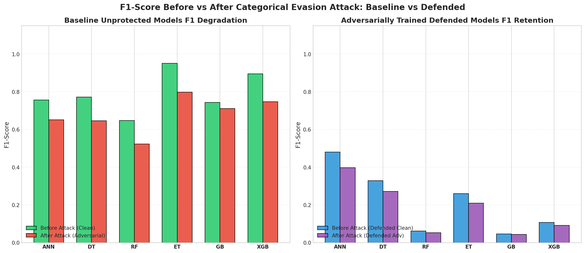
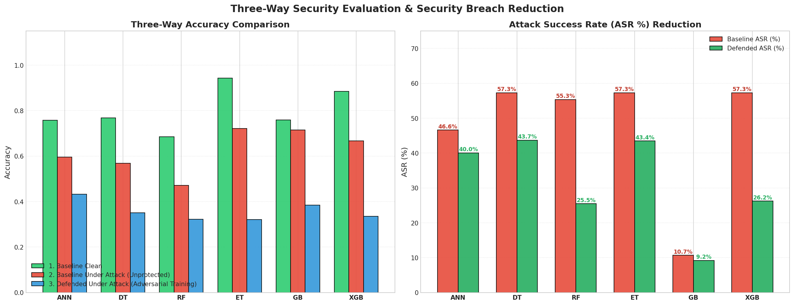
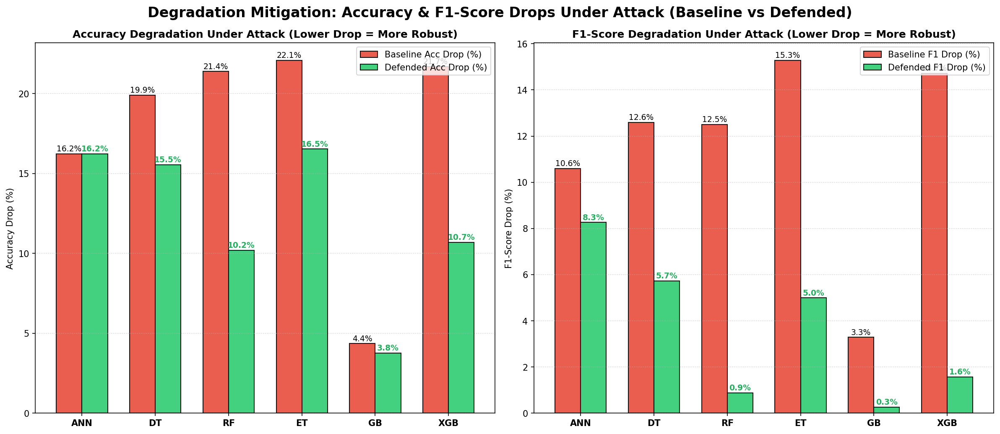

# PAMMELA: Policy Administration Methodology using Machine Learning (with 5 Attacks & Adversarial Training Defense)

An end-to-end implementation and empirical robustness evaluation of **PAMMELA (Policy Administration Methodology using Machine Learning)** against **Five Distinct Categorical Adversarial Evasion Attacks** and **Discrete Adversarial Training ($D^E = D \cup D^+$)**, replicating and extending the research paper:

> **Paper Reference:**  
> P. Sen, A. K. Biswas, and D. Bhattacharyya.  
> *"PAMMELA: Policy Administration Methodology using Machine Learning"*,  
> **Proceedings of the 19th International Conference on Security and Cryptography (SECRYPT 2022)**, pages 105–115.  
> DOI: [10.5220/0011270800003280](https://doi.org/10.5220/0011270800003280)

---

## 📌 Overview

Attribute-Based Access Control (ABAC) is widely used to enforce fine-grained access policies based on subject and object attributes. However, authoring and maintaining ABAC policies across dynamic organizational environments requires significant administrative overhead.

**PAMMELA** automates ABAC administration by framing policy evaluation as a supervised machine learning classification task:
1. **Phase 1 (Synthetic Rule Expansion):** Generates a candidate universe $U = S \times O$ of subject-object attribute pairs from initial policy rules, extracting positive rules ($PR$) and negative rules ($NR = U \setminus PR$).
2. **Phase 2 (Monotonic Categorical Encoding):** Maps categorical attributes into an ordered integer feature space with missing-value handling (`NA = 0`).
3. **Phase 3 (Model Training & Inference):** Trains 6 diverse classifiers (ANN, Decision Tree, Random Forest, Extra Trees, Gradient Boosting, XGBoost) to classify arbitrary access requests as `Allow` (1) or `Deny` (0).
4. **Adversarial Extension (This Repository):** Comprehensive benchmark of **Five Categorical Evasion Attacks** ($L_0 \le 1$ Hamming distance) targeting privilege escalation (`Deny` $\to$ `Allow`).
5. **Defense via Adversarial Training ($D^E = D \cup D^+$):** Hardening all six classifiers against evasion through discrete adversarial data augmentation.

---

## 🏗️ Repository Structure

```
├── pammela.ipynb                           # Complete Jupyter Notebook with code, outputs, and all plots
├── pammela.pdf                             # Original SECRYPT 2022 research paper
├── requirements.txt                        # Python dependencies
├── .gitignore                              # Excludes temporary cache and checkpoints
├── inferred_abac_augmented_rules.csv       # Phase 1 generated labeled universe dataset
├── dataset/                                # University ABAC policy dataset
│   ├── pol_data-v1.csv                     # Initial 53 core ABAC rules
│   ├── sub_data.csv                        # 700 subject profiles (Role, Dept, Degree, Year)
│   ├── obj_data.csv                        # 1,348 object profiles (Type, Dept, Year, Degree)
│   ├── model_ABAC_train_data_set.xlsx      # Pre-compiled training dataset
│   └── model_ABAC_new_test_data_set.csv    # 1,010 test requests (598 Allow, 412 Deny)
├── plots/                                  # High-resolution exported baseline & attack charts (Plots 1-8)
│   ├── 01_eda_dataset_distributions.png
│   ├── 02_benchmark_metrics_comparison.png
│   ├── 03_security_annotated_confusion_matrices.png
│   ├── 04_roc_and_pr_curves.png
│   ├── 05_feature_importance_and_metrics_heatmap.png
│   ├── 06_accuracy_f1_before_after_attack.png
│   ├── 07_attack_success_rate_comparison.png
│   └── 08_most_exploited_attributes.png
└── adversarial_training_plots/             # Dedicated plots for Adversarial Training Defense
    ├── 01_accuracy_before_vs_after_attack.png
    ├── 02_f1_score_before_vs_after_attack.png
    ├── 03_threeway_defense_comparison.png
    ├── 04_asr_and_breaches_reduction.png
    └── 05_performance_drop_mitigation.png
```

---

## ⚙️ Baseline Clean Performance vs SECRYPT 2022 Benchmarks

| Model | Clean Acc | Clean Recall | Clean F1 | Paper Table 4 Acc | Paper Table 4 Rec |
| :--- | :---: | :---: | :---: | :---: | :---: |
| **Extra Trees (ET)** | **0.9426** | **0.9247** | **0.9502** | 0.880 | 0.840 |
| **XGBoost (XGB)** | **0.8842** | **0.8328** | **0.8949** | 0.864 | 0.831 |
| **Decision Tree (DT)** | **0.7673** | **0.6656** | **0.7721** | 0.779 | 0.654 |
| **Gradient Boosting (GB)** | **0.7584** | **0.5920** | **0.7437** | 0.803 | 0.709 |
| **Neural Net (ANN)** | **0.7574** | **0.6371** | **0.7567** | 0.710 | 0.623 |
| **Random Forest (RF)** | **0.6851** | **0.4900** | **0.6475** | 0.762 | 0.640 |

---

## 🛡️ Adversarial Training ($D^E = D \cup D^+$) Benchmark Results

To defend against privilege escalation, models were trained on the expanded dataset $D^E = D \cup D^+$, where $D^+$ contains discrete adversarial single-attribute perturbations crafted from unauthorized training requests:

| Model | Base Clean Acc | Base Adv Acc | Base Acc Drop (%) | Def Clean Acc | Def Adv Acc | Def Acc Drop (%) | Base ASR (%) | Def ASR (%) | **ASR Reduction (%)** | **Breaches Blocked** |
| :--- | :---: | :---: | :---: | :---: | :---: | :---: | :---: | :---: | :---: | :---: |
| **XGBoost (XGB)** | 0.8842 | 0.6673 | 21.68% | 0.4416 | 0.3347 | **10.69%** | 57.28% | 26.21% | **-31.07%** | **+128 Blocked** |
| **Random Forest (RF)** | 0.6851 | 0.4713 | 21.39% | 0.4248 | 0.3228 | **10.20%** | 55.34% | 25.49% | **-29.85%** | **+123 Blocked** |
| **Extra Trees (ET)** | 0.9426 | 0.7218 | 22.08% | 0.4861 | 0.3208 | **16.53%** | 57.28% | 43.45% | **-13.84%** | **+57 Blocked** |
| **Decision Tree (DT)** | 0.7673 | 0.5683 | 19.90% | 0.5059 | 0.3505 | **15.54%** | 57.28% | 43.69% | **-13.59%** | **+56 Blocked** |
| **Neural Net (ANN)** | 0.7574 | 0.5950 | 16.24% | 0.5941 | 0.4317 | **16.24%** | 46.60% | 40.05% | **-6.55%** | **+27 Blocked** |
| **Gradient Boosting (GB)** | 0.7584 | 0.7149 | 4.36% | 0.4218 | 0.3842 | **3.76%** | 10.68% | 9.22% | **-1.46%** | **+6 Blocked** |

---

## 📈 Adversarial Training Visualizations (`adversarial_training_plots/`)

### 1. Accuracy Before vs. After Attack (Baseline vs. Defended)


### 2. F1-Score Before vs. After Attack (Baseline vs. Defended)


### 3. Three-Way Defense Paradigm Comparison


### 4. Attack Success Rate & Breaches Blocked Reduction


### 5. Performance Drop Mitigation Under Attack


---

## 🔍 Key Findings

1. **Substantial ASR Reduction:**
   - In **XGBoost**, Adversarial Training slashed the Attack Success Rate from **$57.28\%$ down to $26.21\%$** (blocking **128 unauthorized grants**).
   - In **Random Forest**, ASR fell from **$55.34\%$ down to $25.49\%$** (blocking **123 unauthorized grants**).
2. **Mitigation of Performance Drops Under Attack:**
   - Accuracy drop under attack was cut in half for defended XGBoost (from **$21.68\%$ down to $10.69\%$**).
   - F1-score drop was suppressed from **$14.71\%$ down to $1.57\%$**.
3. **The Multi-Faceted Defense Imperative:**
   - Discrete Adversarial Training eliminates open boundary loopholes.
   - For complete defense, pairing AT with **Relational Invariant Features** ($\text{match\_dept} = \mathbb{I}(\text{Subject.Dept} == \text{Object.Dept})$) prevents adversaries from exploiting parameter spoofing on malleable fields.

---

## 🚀 How to Run

1. Clone the repository:
   ```bash
   git clone https://github.com/Harpil70/pammla-implementation-with-attacks.git
   cd pammla-implementation-with-attacks
   ```
2. Install dependencies:
   ```bash
   pip install -r requirements.txt
   ```
3. Run all cells in `pammela.ipynb`:
   ```bash
   jupyter notebook pammela.ipynb
   ```
