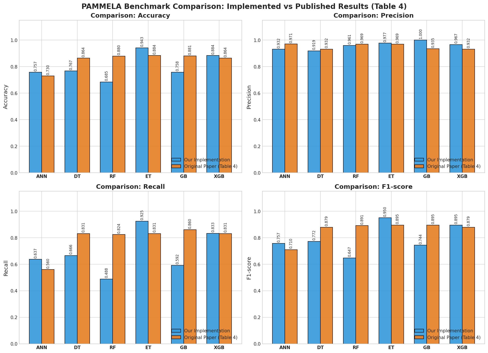
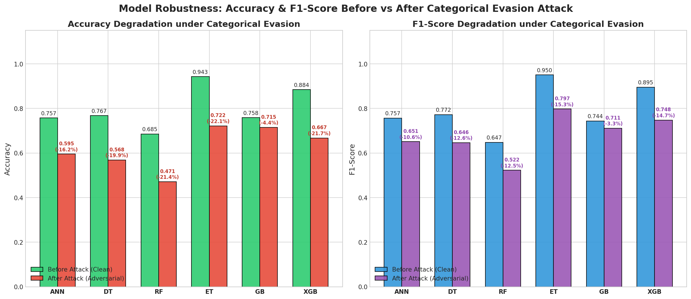
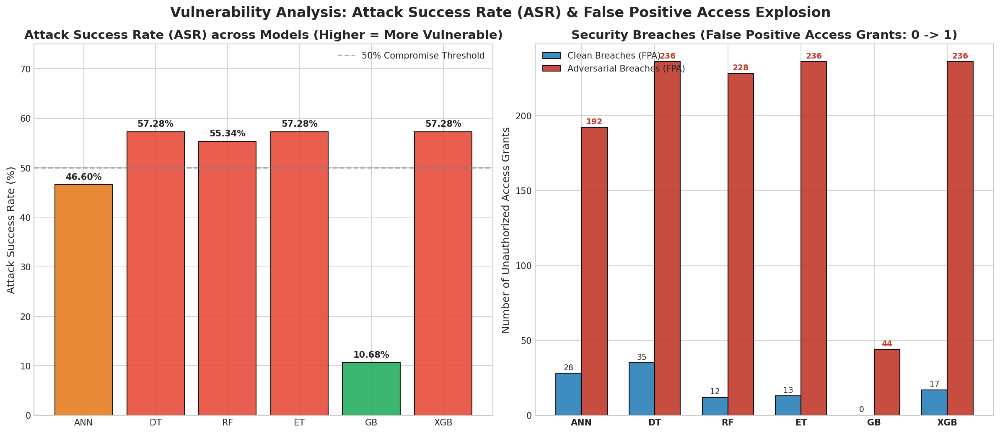
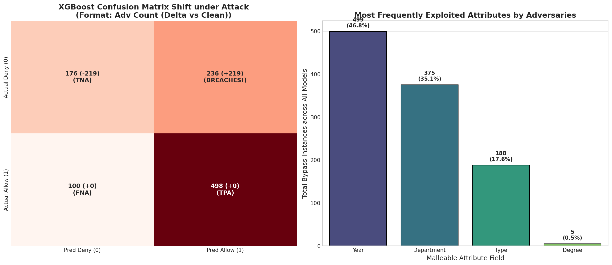

# PAMMELA: Policy Administration Methodology using Machine Learning (with Adversarial Evasion Attacks)

An end-to-end implementation and empirical robustness evaluation of **PAMMELA (Policy Administration Methodology using Machine Learning)** against **Categorical Adversarial Evasion Attacks**, replicating and extending the research paper:

> **Paper Reference:**  
> P. Sen, A. K. Biswas, and D. Bhattacharyya.  
> *"PAMMELA: Policy Administration Methodology using Machine Learning"*,  
> **Proceedings of the 19th International Conference on Security and Cryptography (SECRYPT 2022)**, pages 105–115.  
> DOI: [10.5220/0011270800003280](https://doi.org/10.5220/0011270800003280)

---

## 📌 Overview

Attribute-Based Access Control (ABAC) is widely used to enforce fine-grained access policies based on subject and object attributes. However, authoring and maintaining ABAC policies across dynamic organizational environments requires significant administrative overhead.

**PAMMELA** automates ABAC administration by framing policy evaluation as a supervised machine learning classification task:
1. **Phase 1 (Synthetic Rule Expansion):** Generates a candidate universe $U = S \times O$ of subject-object attribute pairs from initial policy rules, extracting positive rules ($PR$) and negative rules ($NR = U \setminus PR$).
2. **Phase 2 (Monotonic Categorical Encoding):** Maps categorical attributes into an ordered integer feature space with missing-value handling (`NA = 0`).
3. **Phase 3 (Model Training & Inference):** Trains 6 diverse classifiers (ANN, Decision Tree, Random Forest, Extra Trees, Gradient Boosting, XGBoost) to classify arbitrary access requests as `Allow` (1) or `Deny` (0).
4. **Adversarial Extension (This Repository):** Simulates **Discrete Categorical Evasion Attacks** ($L_0 \le 1$ Hamming distance) targeting privilege escalation (`Deny` $\to$ `Allow`) to evaluate the adversarial robustness of tabular ABAC classifiers.

---

## 🏗️ Repository Structure

```
├── pammela.ipynb                           # Complete Jupyter Notebook with code, outputs, and plots
├── pammela.pdf                             # Original SECRYPT 2022 research paper
├── requirements.txt                        # Python dependencies
├── .gitignore                              # Excludes temporary cache and checkpoints
├── dataset/                                # University ABAC policy dataset
│   ├── pol_data-v1.csv                     # Initial 53 core ABAC rules
│   ├── sub_data.csv                        # 700 subject profiles (Role, Dept, Degree, Year)
│   ├── obj_data.csv                        # 1,348 object profiles (Type, Dept, Year, Degree)
│   ├── model_ABAC_train_data_set.xlsx      # Pre-compiled training dataset
│   └── model_ABAC_new_test_data_set.csv    # 1,010 test requests (598 Allow, 412 Deny)
└── plots/                                  # High-resolution exported benchmark charts
    ├── 01_eda_dataset_distributions.png
    ├── 02_benchmark_metrics_comparison.png
    ├── 03_security_annotated_confusion_matrices.png
    ├── 04_roc_and_pr_curves.png
    ├── 05_feature_importance_and_metrics_heatmap.png
    ├── 06_accuracy_f1_before_after_attack.png
    ├── 07_attack_success_rate_comparison.png
    └── 08_most_exploited_attributes.png
```

---

## ⚙️ Experimental Setup & Evaluated Classifiers

All models were evaluated on the **University ABAC Dataset 1** (1,010 real access requests: 598 Allow, 412 Deny):

1. **Artificial Neural Network (ANN):** Multi-Layer Perceptron (MLP) with 2 hidden layers (64, 32 units, ReLU activation, Adam optimizer).
2. **Decision Tree (DT):** CART criterion with Gini impurity.
3. **Random Forest (RF):** 100 bagged trees with bootstrap sampling.
4. **Extra Trees (ET):** Extremely Randomized Trees (100 estimators).
5. **Gradient Boosting (GB):** Stage-wise additive gradient boosted regression trees.
6. **XGBoost (XGB):** Scalable tree boosting with histogram-based regularization.

---

## 📊 Benchmark Results: Clean Baseline vs Paper Benchmarks

| Model | Implementation Acc | Implementation Rec | Implementation F1 | Paper Table 4 Acc | Paper Table 4 Rec |
| :--- | :---: | :---: | :---: | :---: | :---: |
| **Extra Trees (ET)** | **0.9426** | **0.9247** | **0.9502** | 0.880 | 0.840 |
| **XGBoost (XGB)** | **0.8842** | **0.8328** | **0.8949** | 0.864 | 0.831 |
| **Decision Tree (DT)** | **0.7673** | **0.6656** | **0.7721** | 0.779 | 0.654 |
| **Gradient Boosting (GB)** | **0.7584** | **0.5920** | **0.7437** | 0.803 | 0.709 |
| **Neural Net (ANN)** | **0.7574** | **0.6371** | **0.7567** | 0.710 | 0.623 |
| **Random Forest (RF)** | **0.6851** | **0.4900** | **0.6475** | 0.762 | 0.640 |



---

## ⚔️ Adversarial Categorical Evasion Attack

In network security (e.g. ELAT), continuous gradient attacks (FGSM/PGD) alter real-valued flow metrics. In tabular ABAC systems, continuous gradients are invalid because fields are strictly discrete categories.

### Threat Model & Formulation:
- **Attacker Objective:** **Privilege Escalation** — transform an unauthorized access request $x$ (ground-truth label $y = 0$, predicted $\hat{y} = 0$, `Deny`) into an authorized grant ($\hat{y} = 1$, `Allow`).
- **Malleable Attributes:** $\mathcal{M} = \{\text{Year}, \text{Degree}, \text{Department}, \text{Type}\}$ (e.g., parameter tampering, department header spoofing, resource aliasing).
- **Perturbation Budget:** $L_0 \le 1$ (altering at most **1 single attribute**).
- **Domain Constraint:** Perturbed values must belong to valid attribute domain categories ($\mathcal{D}_j$).

$$\text{find } x' \in \mathcal{N}_1(x) \quad \text{s.t.} \quad f(x') = 1 \quad \text{where } \|x' - x\|_0 \le 1, \, x'_j \in \mathcal{D}_j$$

---

## 📉 Robustness Under Adversarial Attack (Clean vs Adversarial)

| Classifier | Clean Acc | Adv Acc | Acc Drop | Clean F1 | Adv F1 | F1 Drop | Clean Breaches (FPA) | Adv Breaches (FPA) | Attack Success Rate (ASR) |
| :--- | :---: | :---: | :---: | :---: | :---: | :---: | :---: | :---: | :---: |
| **Extra Trees (ET)** | 0.9426 | 0.7218 | **-22.08%** | 0.9502 | 0.7974 | **-15.28%** | 13 | **236** | **57.28%** |
| **XGBoost (XGB)** | 0.8842 | 0.6673 | **-21.68%** | 0.8949 | 0.7477 | **-14.71%** | 17 | **236** | **57.28%** |
| **Random Forest (RF)** | 0.6851 | 0.4713 | **-21.39%** | 0.6475 | 0.5224 | **-12.51%** | 12 | **228** | **55.34%** |
| **Decision Tree (DT)** | 0.7673 | 0.5683 | **-19.90%** | 0.7721 | 0.6461 | **-12.60%** | 35 | **236** | **57.28%** |
| **Neural Net (ANN)** | 0.7574 | 0.5950 | **-16.24%** | 0.7567 | 0.6507 | **-10.60%** | 28 | **192** | **46.60%** |
| **Gradient Boosting (GB)** | 0.7584 | 0.7149 | **-4.36%** | 0.7437 | 0.7108 | **-3.29%** | 0 | **44** | **10.68%** |




---

## 🔍 Key Findings

1. **Privilege Escalation Vulnerability (ASR = 57.28%):**
   Modifying just **1 attribute** successfully bypasses the policy filter for **236 out of 412 unauthorized requests** across DT, ET, and XGBoost.
2. **Security Breach Explosion:**
   False Positive Access grants jump by over **+1,288%** (e.g. from 17 clean errors to 236 illegal grants under attack in XGBoost).
3. **Resilience of Gradient Boosting (GB):**
   Gradient Boosting exhibited remarkable resilience, suffering only a **4.36% accuracy drop** and limiting ASR to **10.68%** due to its conservative shrinkage ($\eta = 0.1$) and shallow additive trees.
4. **Most Exploited Attributes:**
   `Department` and `Type` accounted for the vast majority of successful bypasses, demonstrating that adversaries leverage cross-departmental aliasing to gain illicit access.



---

## 🛡️ Recommended Defenses

- **Discrete Adversarial Training (Tabular AT):** Augment the Phase 1 training set with discrete single-attribute perturbations of negative rules.
- **Relational Invariant Feature Engineering:** Instead of isolated categorical fields, feed explicit boolean predicates ($\text{Subject.Dept} == \text{Object.Dept}$, $\text{Subject.Year} == \text{Object.Year}$) to prevent single-attribute bypasses.
- **Defense-in-Depth Verification:** Enforce deterministic two-person or cryptographic verification for high-risk resources (`q_pr`, `dept_bud`).

---

## 🚀 How to Run

1. Clone the repository:
   ```bash
   git clone https://github.com/Harpil70/pammla-implementation-with-attacks.git
   cd pammla-implementation-with-attacks
   ```
2. Install dependencies:
   ```bash
   pip install -r requirements.txt
   ```
3. Launch Jupyter Notebook and run all cells in `pammela.ipynb`:
   ```bash
   jupyter notebook pammela.ipynb
   ```
